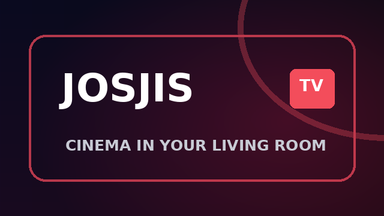
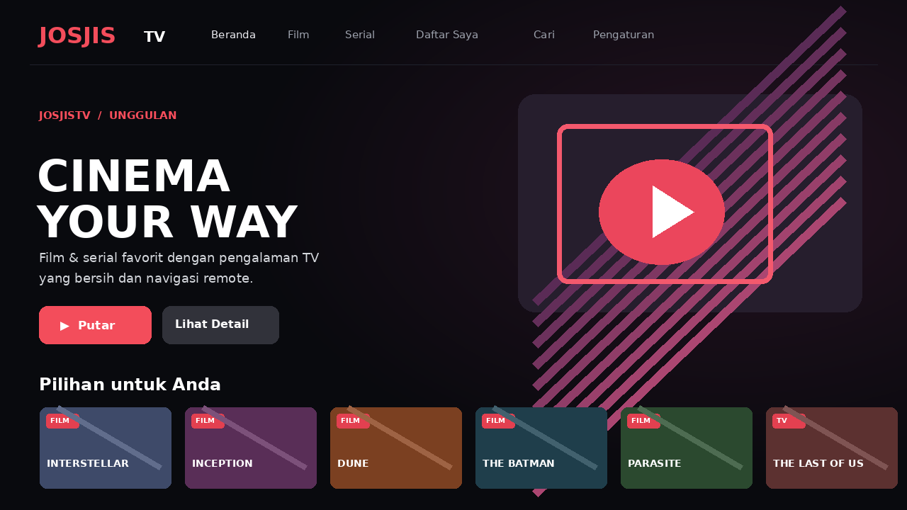

# JosJisTV 📺

A lightweight Android TV front end with a Netflix-inspired **original** dark UI, D-pad navigation, TMDB optional metadata/catalog, and embedded frameXTV playback.

> **Status:** Source project ready for Gradle / Android Studio / GitHub Actions builds. Not a prebuilt APK. Streaming depends on a third-party iframe service and has **not** been verified on a physical Android TV device. No stream extraction or DRM circumvention is included.



**UI concept preview (illustration, not a device screenshot):**



## v1.0.2 — Android TV / TV Box launcher compatibility

Fix for reports that Android TV reports installation complete but shows no **Open/Buka** button.

- The same `MainActivity` can be launched via either `android.intent.category.LEANBACK_LAUNCHER` (Android TV home) or standard `android.intent.category.LAUNCHER` (TV boxes, alternate launchers, installers).
- Declares Leanback as an optional device feature so the APK can also be sideloaded on compatible AOSP TV boxes that do not expose it.
- Gives the *Beranda* navigation item initial remote focus.
- Updated `versionCode` to `2` and `versionName` to `1.0.2`.

**Install:** Build using GitHub Actions, unzip the `JosJisTV-debug-apk` artifact, then install `app-debug.apk`. Check the TV home screen's *Apps / Aplikasi* screen. Some installer apps show only **Done / Selesai** even when the app is launchable; launcher support depends on the TV model.

**Debug if the app opens and immediately closes:** Enable developer options and USB/network debugging, connect ADB and run:

```bash
adb shell am start -n com.josjis.tv/.MainActivity
adb logcat -d -s AndroidRuntime:E ActivityTaskManager:I
```

Look for `FATAL EXCEPTION` or `com.josjis.tv` and share the relevant lines. A launcher fix will not solve unrelated runtime crashes or unsupported Android versions (minimum Android 6.0 / API 23).

## Fitur / Features

- Full-screen Android TV launcher (Leanback), landscape, original dark cinematic layout
- Beranda, Film, Serial, Daftar Saya, Cari, Pengaturan
- Native D-pad focus, thumbnail rows, featured hero, detail screen
- Film and TV metadata via the official **TMDB v3 API**, with user-supplied key/token
- Built-in **sample catalog** without an API key (examples only; not guaranteed playable)
- Episode selection for TV series (TMDB season metadata available with token)
- Watchlist and recently played list stored locally on the TV
- FrameXTV embed constructed from TMDB ID; JavaScript `postMessage` commands for play/pause/seek/subtitle
- Optional original iframe controls fallback (button: **Kontrol bawaan**)
- GitHub Actions workflow builds a debug APK and publishes it as an action artifact
- No third-party Android libraries; just Java and platform WebView

## Important: API architecture

**FrameXTV is not documented as a movie catalog API.** Its public documentation at [framextv.cc/api](https://framextv.cc/api) describes an **iframe embed and JavaScript messaging** interface:

```text
Movie: https://framextv.xyz/embed/{tmdbId}
TV:    https://framextv.xyz/embed/{tmdbId}/{season}/{episode}
```

JosJisTV integrates this documented interface. It does **not** claim to offer a native/direct HLS or MP4 playback API. The player remains a third-party embed inside a native Android WebView; FrameXTV may show its own overlays, or fail entirely depending on source availability, content rights, JavaScript restrictions, Android System WebView compatibility, and remote-control support.

**TMDB** is a separate metadata catalog; it does not serve the films/videos. Get your own API key or Read Access Token from [TMDB](https://www.themoviedb.org/settings/api). TMDB key not included in the repo.

### Sample mode / Katalog contoh

Out of the box, the app displays a **curated sample list** based on well-known TMDB IDs; thumbnails will be styled placeholders and list ordering is not live. Set a TMDB key in Pengaturan to load actual posters, popular movies, trending titles and searchable items.

### TMDB configuration in the TV app

1. Open **Pengaturan** using your TV remote.
2. Paste a personal **TMDB v3 API Key** (short hexadecimal key) **or** an API Read Access Token (Bearer JWT).
3. Choose **Simpan & muat ulang katalog**.
4. Browse and open a movie or series. TV season/episode metadata uses TMDB.

**Security:** Token is stored in private local SharedPreferences, not bundled or checked into GitHub. For a public distributed app, a server-side proxy is recommended to keep an owner-operated API credential secret. Individual users should use their own token for this prototype.

## Build with Android Studio (Windows / macOS / Linux)

Required: Android Studio, Android SDK 35, Java/JDK 17 or newer, network access for Gradle/SDK dependencies.

1. Clone or download this repository.
2. In Android Studio: **File > Open > `josjis-tv`**.
3. Wait for Gradle sync (project uses Android Gradle Plugin **8.13.2**, Gradle **8.13**).
4. Install SDK Platform 35 and Build Tools if prompted.
5. Select **Build > Build Bundle(s) / APK(s) > Build APK(s)**.
6. The debug APK will be in `app/build/outputs/apk/debug/app-debug.apk`.

Alternatively, from repo root (with Android SDK environment configured):

**Windows:**
```powershell
.\gradlew.bat assembleDebug
```

**Linux/macOS:**
```bash
./gradlew assembleDebug
```

The included `gradlew` and `gradlew.bat` are **minimal, auditable bootstrap scripts**, not the official Gradle wrapper JAR. They use a local Gradle executable when installed, otherwise download pinned Gradle 8.13 under your home directory. The `gradle/wrapper/gradle-wrapper.properties` is also provided for Android Studio. If you prefer the standard Gradle wrapper, generate it locally using `gradle wrapper --gradle-version 8.13` after installing Gradle, then commit the normal wrapper files.

## GitHub Actions: build without a local Android SDK

Every push to `main` or `master` and manual workflow trigger builds an installable **debug** APK:

1. Open the repository's **Actions** tab.
2. Choose **Android TV APK** and **Run workflow** (or push a commit).
3. Download the artifact `JosJisTV-debug-apk` from the successful run.
4. Extract and install `app-debug.apk` on your TV using ADB or a file manager.

> A CI workflow is included, but has not yet run against this new source tree; review the Actions logs for environment-related build failures.

### Install with ADB

```bash
adb connect TV_IP_ADDRESS:5555
adb install -r app/build/outputs/apk/debug/app-debug.apk
```

ADB-over-network access varies by Android TV OS version; enable developer/wireless debugging on your device as appropriate.

### Push to your GitHub repo

```bash
git init
git add .
git commit -m "Initial JosJisTV Android TV app"
git branch -M main
git remote add origin https://github.com/efendiyhy/josjis-tv.git
git push -u origin main
```

If the GitHub repository already contains commits (such as README/LICENSE), clone it first and copy these project files into the cloned folder rather than overwriting remote history.

## Struktur proyek / Structure

```text
app/src/main/java/com/josjis/tv/
  MainActivity.java        # TV homepage, nav, details, search, settings
  PlayerActivity.java      # FrameXTV WebView embed and native remote controls
  CatalogRepository.java  # Official TMDB API + sample catalog
  Media.java               # Movie/series data model
  ImageLoader.java         # Lightweight HTTP poster loader + memory cache
  UserStore.java           # Watchlist, recent items and TMDB credential
  Design.java              # Focusable buttons, UI colors and components
.github/workflows/android.yml # Android CI APK builder
```

## Limitations / Batasan

- FrameXTV's public API is an **embed API**, not a provider of direct video URLs. This app intentionally does not scrape/decrypt media.
- Hiding iframe controls (`controls=0`) does **not** guarantee the provider hides all of its branding or overlays.
- Current app includes a sample catalog and optional TMDB online catalog. Availability of a title on FrameXTV is **not guaranteed**.
- Autoplay/codec/HD video/fullscreen/subtitles can vary by TV hardware and System WebView.
- `postMessage` support is based on provider documentation and has not been independently tested on TV hardware.
- A signed release APK, device compatibility testing, parental controls, and full Google Play TV compliance checks are not included.
- You are responsible for obtaining permission from streaming providers and copyright holders for intended use.

## Credits, rights and attribution

JosJisTV is not affiliated with Netflix, FrameXTV, or TMDB. Its layout is an original design inspired by modern TV streaming UX; it does not reuse Netflix assets.

> **This product uses the TMDB API but is not endorsed or certified by TMDB.**

Metadata/artwork via [The Movie Database (TMDB)](https://www.themoviedb.org), subject to its API terms. TMDB requires an **approved logo in the app's credits/about screen** before public distribution; this sample currently includes the textual attribution in Settings. Download and add the approved official logo as required before publishing. Any copyrights in titles, artwork and videos belong to their respective owners.

This source code is available under MIT; the license does **not** grant rights to third-party media content.
